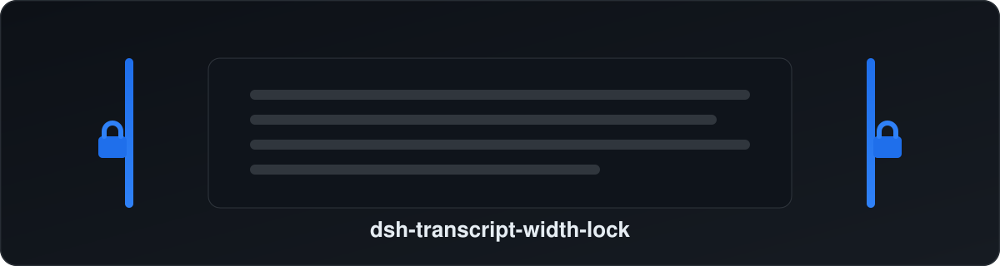

<div align="center">



# dsh-transcript-width-lock

**DeepSeek Harness 桌面端插件 · 让对话正文两侧的宽度拖条清晰可见，并可一键锁定，拖选文字再也不会误改正文宽度。**

[](#license)
[](#兼容性)
[](#安装一条命令)

</div>

---

## 这个插件解决什么问题

DeepSeek Harness 桌面端的主对话区里，正文（消息区）左右两侧各有一根**几乎看不见的拖动条**，用来调整正文的阅读宽度——它**只改变文字栏宽度，不影响左右侧栏**。

原版设计里这两根条：

- 只有约 **10px** 宽，且 **`z-index` 很低**，平时完全藏在内容后面；
- 那条边界提示线 **只在鼠标悬停时才显示**（平时 `opacity:0`）。

结果就是：你在阅读时习惯性地**用鼠标拖蓝选字**，光标一扫到文字两侧的空白边缘就"撞"到这根条，触发了拖动 → 选字被打断、正文宽度被带偏；而且**没有吸附、没有默认位**，想拖回原来的宽度很难对准，换行版式全乱了，还**没法锁定**。

**本插件正是为此而生：**

1. **边界常显** —— 正文两侧常驻一条细边界线，一眼看得出手柄在哪；
2. **可锁定** —— 设置里一个开关，开启后这两根条**彻底拖不动**，于是拖选文字再也不会误改宽度（选字本身不受影响）；
3. **持久记忆** —— 开关状态保存，重启后仍在；**默认开启**，装上就生效。

---

## 功能特性

| | 说明 |
|---|---|
| 👁️ 边界常显 | 正文两侧永久显示一条 2px 的边界线，符合主题明暗配色 |
| 🔒 一键锁定 | 设置 ▸ 常规 ▸ **「锁定正文宽度手柄」**，默认开启 |
| ✍️ 不影响选字 | 锁定时只拦截"拖动改宽度"这一个动作，鼠标拖蓝选字照常 |
| 💾 记忆状态 | 锁状态存 `localStorage`（key：`dsh.conv-width-lock`），重启保留 |
| 🎨 跟随主题 | 只用宿主主题变量，明/暗主题都协调 |
| 🪶 轻量安全 | 纯前端 UI 插件，无网络请求、无数据采集，仅读写一个本地布尔值 |
| ↩️ 随时还原 | 关掉开关即可照常拖动宽度；卸载插件无残留 |

---

## 兼容性

- 面向 **DeepSeek Harness 桌面端**（Electron，Web 前端）。
- 依赖对话组件里 `WidthHandle` 的稳定属性 **`data-width-handle`**（`@deepseek-ai/dsh-client-ui-conversation`，当前版本 `0.2.2-rc.1`）。
- 若将来 DSH 大改导致该属性消失，插件会**安全地不生效**（不报错、不影响其它功能），不会破坏界面。

---

## 安装（一条命令）

> 前提：已安装 **DeepSeek Harness 桌面端**。`<profile>` 一般填 `desktop`（桌面端默认 profile）。

### 方式一：直接从 GitHub 安装（最省事，推荐）

```bash
dsh plugin --profile desktop add "github:sanhaodashu/dsh-transcript-width-lock"
```

> 装完后**完全退出并重新打开**桌面端即可生效。

### 方式二：本地文件夹 / 压缩包

把本仓库下载（或 `git clone`）到本地，然后：

```bash
# 目录形式
dsh plugin --profile desktop add "<路径>/dsh-transcript-width-lock"

# 或用打包好的 tgz / zip 解压后按目录安装
```

### 方式三：npm（如果你已发布到 npm）

```bash
dsh plugin --profile desktop add dsh-transcript-width-lock
```

> 安装命令底层走 pnpm，支持 `npm 名 / github:用户/仓库 / 本地目录 / 本地 tgz`。

---

## 使用

1. 打开 **设置 ▸ 常规（Settings ▸ General）**，找到 **「锁定正文宽度手柄 / Lock transcript width handles」**。
2. 开关**默认已开启**：此时正文两侧的宽度拖条拖不动，随便拖蓝选字都不会改宽度。
3. 想**手动调整阅读宽度**时，把该开关**关掉**，即可拖动正文两侧的细条调整宽度；调好再打开即锁定。

---

## 卸载

```bash
dsh plugin --profile desktop remove dsh-transcript-width-lock
```

然后重启桌面端。插件不写入任何系统级配置，卸载后无残留。

---

## 工作原理（简述）

- 用一段**作用域严格限定**的样式（只针对 `[data-width-handle]`），把官方手柄的边界线改为常显，并适度抬高可点层级；
- 锁定时，在 `pointerdown` 的**捕获阶段**拦截落在手柄上的按下事件（`stopPropagation`），使官方拖动逻辑收不到事件、不会启动——但**不 `preventDefault`**，所以不影响选字；
- 锁状态存在 `localStorage` 的 `dsh.conv-width-lock`，默认 `true`。

插件**只作用于正文宽度手柄**，绝不改动侧栏的其它拖条。

---

## 常见问题

- **重启后没变化？** 请确认最后是**完全退出应用再打开**（不是只刷新窗口），并检查设置里是否出现了该开关。
- **以后 DSH 更新导致失效？** 属正常的安全降级（属性变了就不再匹配），不会报错；等插件更新适配即可。
- **想改默认是否锁定？** 目前默认开启；如需默认关闭可提 issue。

---

## License

[MIT](./LICENSE) © 2026 sanhaodashu

---

<details>
<summary>English (short)</summary>

**dsh-transcript-width-lock** — a DeepSeek Harness **desktop** plugin that makes the
two nearly-invisible transcript-width drag handles visible, and lets you lock them
so drag-to-select never changes the reading width. It only affects the transcript
width handles, never the sidebars.

Install:

```bash
dsh plugin --profile desktop add "github:sanhaodashu/dsh-transcript-width-lock"
```

Then fully restart the app. The toggle lives in **Settings ▸ General ▸ "Lock
transcript width handles"** and is **on by default**. Turn it off to resize the
reading width manually.

</details>
